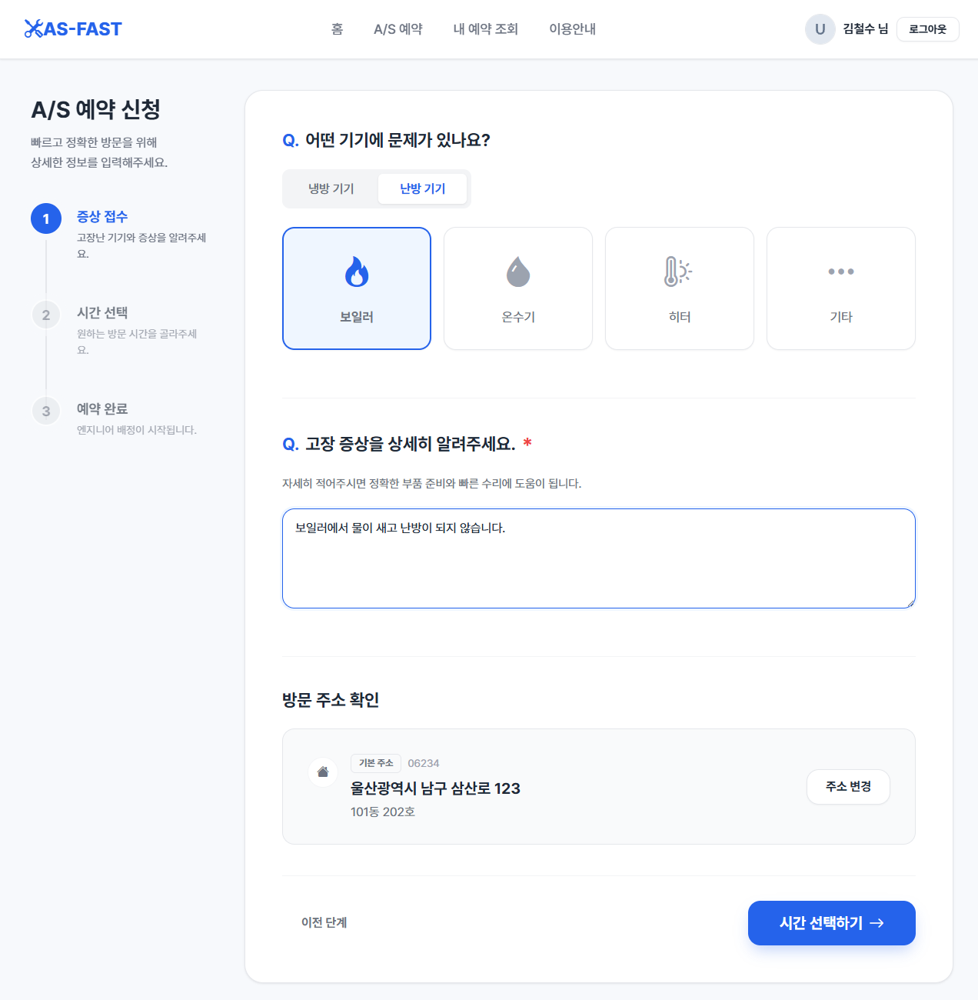
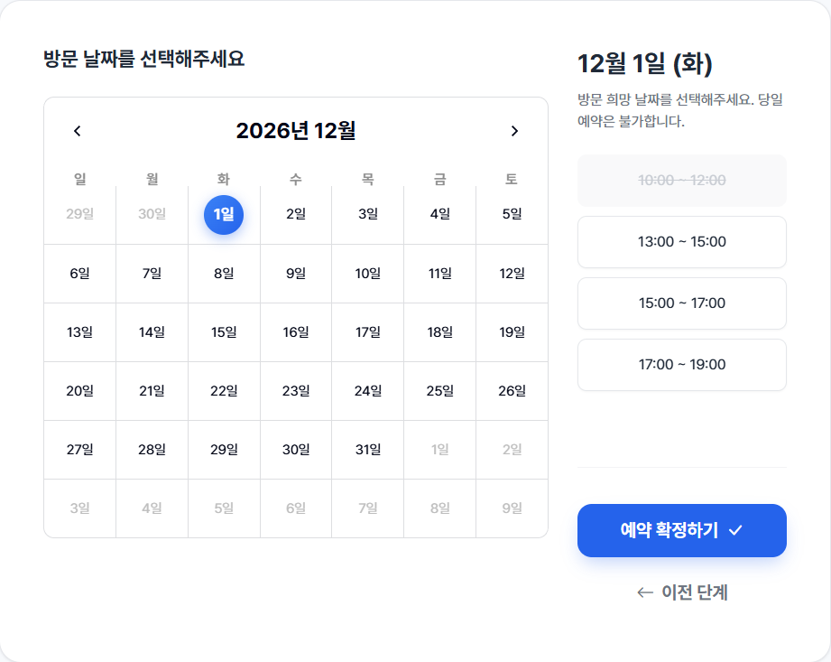
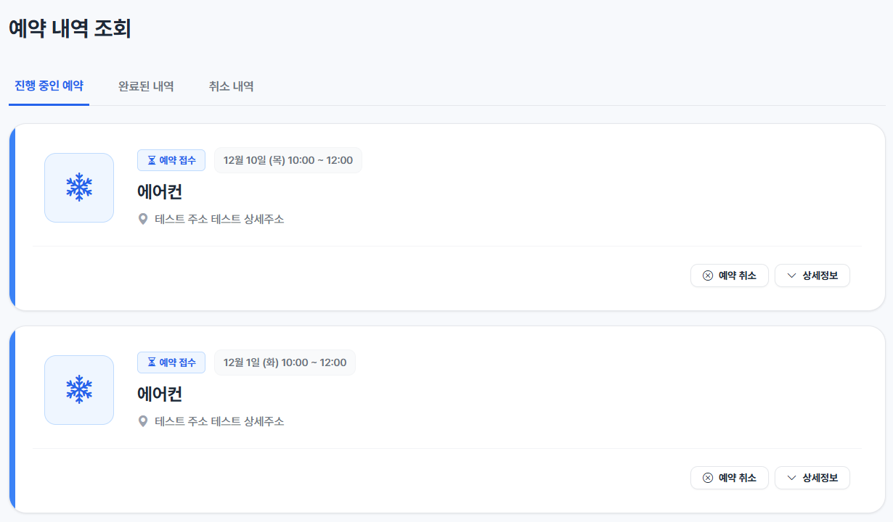
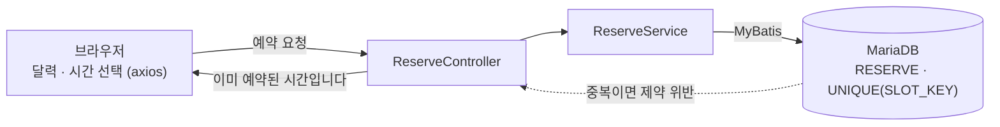

# 냉·난방 AS 실시간 예약 (AS-FAST)

회원이 냉·난방 AS를 **예약·조회·삭제하고 리뷰를 남기면**, 관리자가 접수 현황과 리뷰를 **대시보드로 확인**하는 예약 시스템입니다.
그린AI캠퍼스 1차 팀 프로젝트(COMMIT, 3인 · 2026.09.08 ~ 09.16)입니다.

     

## 예약 기능과 동시 예약 방지

이 저장소에서 저는 **예약 기능**(DB 설계, 동시 예약 방지, 예약 화면)을 구현했습니다.
[내 커밋 보기](https://github.com/isnull0x00/project1/commits/dev?author=isnull0x00)

| 구현 | 결과 (조건) |
|---|---|
| 예약 DB 스키마 | 12개 테이블을 4개로 줄여 설계 |
| 동시 예약 방지 | 2~3건 동시 요청으로 먼저 확인한 뒤, 부족하다고 판단해 같은 날짜·시간에 10건을 동시에 보냈더니 1건만 저장되고 9건은 거절 (브라우저 콘솔에서 직접 전송) |
| 예약 화면 | 달력 · 시간 선택(예약된 시간대는 비활성) · 내역(진행 중·완료·취소 탭, 진행 중만 취소) |
| 날짜·시간 검증 | 달력(내일부터)과 서버가 같은 기준으로 검증 |

예약 내역 조회 화면(`reserve_list`)은 주로 제가 작성했습니다.

### 동시 예약 방지

- **문제:** 자바 `if`로 중복을 확인해도, 확인과 저장 사이의 짧은 틈에 두 요청이 모두 통과해 같은 시간이 이중 예약될 수 있습니다.
- **해결:** MariaDB 가상 컬럼 `SLOT_KEY`에 유니크 인덱스를 걸어, 중복 판단을 DB가 하게 했습니다. 취소된 예약은 키가 `NULL`이라 같은 시간에 다시 예약할 수 있습니다.
- **확인:** 처음에는 2~3건을 동시에 보내 확인했고, 그 정도로는 부족하다고 보아 10건으로 늘려 같은 날짜·슬롯으로 보냈습니다. 1건만 저장되고 9건이 "이미 예약된 시간입니다"로 차단되었으며, DB 조회에서도 1건만 있었습니다.

<details>
<summary>검토한 방식과 동작 방식 보기</summary>

| 방식 | 판단 |
|---|---|
| 비관적 락 (`SELECT ... FOR UPDATE`) | 다른 요청이 대기열에 묶여, 단순한 신규 예약에는 오버헤드가 크다고 판단했습니다. |
| 낙관적 락 (`@Version`) | 이미 있는 행을 수정할 때 쓰는 방식이라, 새 행을 넣는 예약 생성에는 맞지 않았습니다. |
| `UNIQUE(날짜, 슬롯)` | 취소된 예약 행이 남아 있어 같은 시간을 다시 예약할 수 없었습니다. 취소 이력은 지울 수 없어서 쓰지 않았습니다. |
| 가상 컬럼 `SLOT_KEY` + 유니크 (채택) | 취소 건은 키가 `NULL`이 되어 유니크 검사에서 빠지고, 취소 처리에서 키를 따로 비울 필요가 없습니다. |

```sql
ALTER TABLE RESERVE ADD COLUMN SLOT_KEY VARCHAR(30) AS (
  IF(RESERVE_STATUS <> 'C', CONCAT(RESERVE_DATE, '-', SLOT_NO), NULL)
) VIRTUAL;
ALTER TABLE RESERVE ADD CONSTRAINT UX_RESERVE_SLOT UNIQUE (SLOT_KEY);
```

1. 두 번째 요청의 `INSERT`가 유니크 인덱스에 막혀 중복 오류가 납니다.
2. 컨트롤러가 `DataIntegrityViolationException`을 받아 "이미 예약된 시간입니다"로 응답합니다([`ReserveController.java`](src/main/java/com/commit/project1/reserve/controller/ReserveController.java#L140-L146)).

**한계:** 위 스키마 SQL은 이 저장소에 없습니다. 동시 요청 시험은 브라우저 콘솔에서 직접 보낸 것이고 자동 테스트로는 옮기지 않았습니다.

</details>

## 화면


> 로그인 → AS 예약(제품 · 일정 선택) → 예약 내역 조회 → 리뷰 작성 → 관리자 대시보드 순서의 시연입니다.

### 예약 화면

| 1단계: 기기와 증상 | 2단계: 날짜·시간 선택 |
|---|---|
|  |  |
| 냉방·난방 기기를 고르고 증상을 입력, 방문 주소 확인 | 날짜를 고르면 예약 가능한 시간대가 비동기로 나타나고, 이미 예약된 시간대(10:00~12:00)는 비활성으로 표시 |



> 예약 내역을 진행 중·완료·취소 탭으로 나눠 보여 주고, 진행 중 예약은 취소 가능

## 주요 기능

| | |
|---|---|
| 카테고리 통계 | 예약이 0건인 카테고리도 보이도록 `RIGHT OUTER JOIN`으로 건수 집계 |
| 리뷰 통계 | 전체 건수 · 평균 평점 · 별점별 개수를 **한 번의 쿼리**로 집계 |
| 예약 흐름 | 제품 → 일정 → 확정의 3단계 화면 (FullCalendar, axios 비동기) |
| 데이터 | `RESERVE` 테이블 중심으로 5개 테이블 연결 |

## 구조



```
src/main/java/com/commit/project1
├─ member    회원 · 로그인
├─ reserve   예약 (Controller / Service / Mapper / DTO)
├─ review    리뷰
└─ admin     관리자 대시보드
src/main/resources
├─ mapper    MyBatis XML
├─ templates Thymeleaf (layouts / pages)
└─ static    CSS · JS
```

## 핵심 코드

| 하는 일 | 위치 |
|---|---|
| 동시 예약 중복을 사용자 메시지로 바꾸는 처리 | [`ReserveController.java`](src/main/java/com/commit/project1/reserve/controller/ReserveController.java#L140-L146) |
| 이미 예약된 슬롯 번호 조회(취소 제외) | [`reserve-mapper.xml`](src/main/resources/mapper/reserve-mapper.xml#L51) |
| 예약 시간(타임슬롯) 선택 화면 | [`reserve_time.js`](src/main/resources/static/js/pages/reserve/reserve_time.js) |
| 예약 내역 조회 화면 | [`reserve_list.js`](src/main/resources/static/js/pages/reserve/reserve_list.js) |
| 유니크 제약(가상 컬럼 `SLOT_KEY`) | 위 "동시 예약 방지"의 SQL (스키마 파일은 이 저장소에 없습니다) |

```java
try {
  reserveService.saveReserve(dto);
} catch (DataIntegrityViolationException e) {
  result.put("success", false);
  result.put("error", "이미 예약된 시간입니다.");
  return result;
}
```

DB의 중복 오류를 서비스 코드가 직접 판단하지 않고, 예외를 받아 사용자 메시지로만 바꿉니다.

## 실행

1. MariaDB에 `project-1` 데이터베이스를 준비합니다. (스키마 SQL은 이 저장소에 없습니다.)
2. `src/main/resources/application.yaml`의 DB 접속 정보와 업로드 경로(`file.upload.dir`)를 본인 환경에 맞게 고칩니다.
3. 실행합니다.

```bash
./gradlew bootRun
```

## 측정 조건과 범위

- **동시 예약 시험**: 브라우저 콘솔에서 같은 날짜·슬롯으로 직접 보낸 요청(2~3건, 10건)으로 확인했고, 자동 테스트로는 옮기지 않았습니다.
- **통계**: 요청마다 전체 테이블을 집계하는 방식이라, 현재 데이터 규모에 맞춘 구조입니다. 데이터가 커지면 집계 결과를 저장하는 방식을 검토합니다.
- **예약 거절 시점**: 시간을 고른 뒤 제출 시점에 거절 여부를 알게 됩니다. 시간을 고른 즉시 알려 주는 구조(예: Redis 슬롯 홀딩)가 다음 과제입니다.
- **기사 배정**: 기사 테이블이 없어 임시 번호로 저장하며, 배정 기능은 구현 범위에 넣지 않았습니다.
- **스키마 SQL**: 이 저장소에 포함되어 있지 않습니다.

## 기록

- [개발 일지 (Notion)](https://elderly-chill-2ac.notion.site/9b7e1a8cb19f83de90b9817b1c102e5e)
