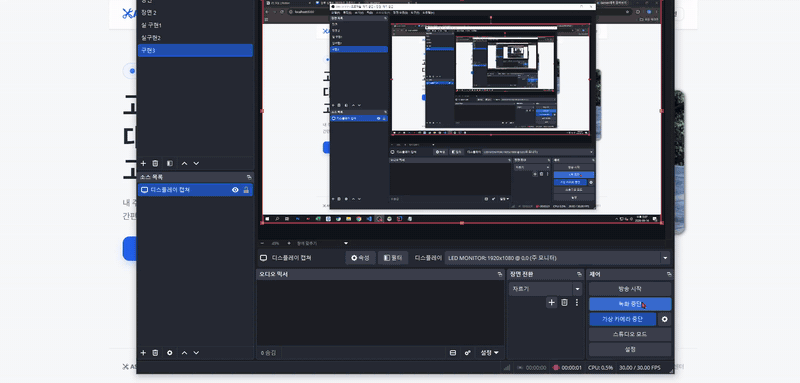

# 냉·난방 AS 실시간 예약 (AS-FAST)

회원이 냉·난방 AS를 **예약·조회·삭제하고 리뷰를 남기면**, 관리자가 접수 현황과 리뷰를 **대시보드로 확인**하는 예약 시스템입니다.
그린AI캠퍼스 1차 팀 프로젝트(COMMIT, 3인 · 2026.09.08 ~ 09.16)이며, 저는 팀장이었습니다.



> 로그인 → AS 예약(제품 · 일정 선택) → 예약 내역 조회 → 리뷰 작성 → 관리자 대시보드 순서의 시연입니다.

## 한눈에 보기

| | |
|---|---|
| 동시 예약 | 같은 시간대에 동시 요청 10건을 보내 **1건만 저장**되고 9건은 거부됨을 확인 |
| 리뷰 통계 | 전체 건수 · 평균 평점 · 별점별 개수를 **한 번의 쿼리**로 집계 |
| 예약 흐름 | 제품 → 일정 → 확정의 3단계 화면 (FullCalendar, axios 비동기) |
| 데이터 | `RESERVE` 테이블 중심으로 5개 테이블 연결 |

## 제가 맡은 부분

- 메인 화면(예약일 표시) · 로그인/로그아웃
- **동시 예약 방지**: 자바 코드로 빈 시간을 확인하는 것만으로는 동시 요청의 충돌을 막을 수 없어, `SLOT_KEY` + `UNIQUE` 제약으로 DB가 같은 날짜·슬롯을 1건만 허용하게 했습니다.
- 관리자 예약 접수 건수 통계, 리뷰 DB 설계와 Spring 구현, 리뷰 데이터를 관리자 페이지에 연결

## 핵심 코드

| 주제 | 위치 |
|---|---|
| 중복 예약 검사 | [`ReserveService.java`](src/main/java/com/commit/project1/reserve/service/ReserveService.java#L119) |
| 중복 예약 응답 | [`ReserveController.java`](src/main/java/com/commit/project1/reserve/controller/ReserveController.java#L144) |
| 리뷰 통계 한 번에 집계 (`CASE WHEN` + `HashMap`) | [`review-mapper.xml`](src/main/resources/mapper/review-mapper.xml#L36) |

```xml
<select id="selectStats" resultType="HashMap">
  SELECT COUNT(*) AS totalCount, ROUND(AVG(RATING), 1) AS avgRating,
         SUM(CASE WHEN RATING = 5 THEN 1 ELSE 0 END) AS star5,
         SUM(CASE WHEN RATING = 4 THEN 1 ELSE 0 END) AS star4,
         SUM(CASE WHEN RATING <= 3 THEN 1 ELSE 0 END) AS star3Below
  FROM REVIEW
</select>
```

## 기술 스택

Java 17 · Spring Boot · MyBatis · Thymeleaf · MariaDB · JavaScript(axios) · FullCalendar · Gradle

## 구조

```
src/main/java/com/commit/project1
├─ member    회원 · 로그인
├─ reserve   예약 (Controller / Service / Mapper / DTO)
├─ review    리뷰
└─ admin     관리자 대시보드
src/main/resources
├─ mapper    MyBatis XML
├─ templates Thymeleaf (layouts / pages)
└─ static    CSS · JS
```

## 실행

1. MariaDB에 `project-1` 데이터베이스를 준비합니다. (스키마 SQL은 이 저장소에 없습니다.)
2. `src/main/resources/application.yaml`의 DB 접속 정보와 업로드 경로(`file.upload.dir`)를 본인 환경에 맞게 고칩니다.
3. 실행합니다.

```bash
./gradlew bootRun
```

## 한계와 다음 단계

- DB 제약은 중복을 막지만, 사용자는 **제출한 뒤에야** 거절을 알게 됩니다. 일정을 고르는 시점에 알려 주도록 Redis 슬롯 홀딩(TTL) 도입을 검토합니다.
- 동시 예약 10건 실험은 브라우저 콘솔(`Promise.all`)로 한 수동 확인이며, 자동 테스트로는 만들지 않았습니다.

## 기록

- [프로젝트 작업 일지 (Notion)](https://fluffy-plane-19c.notion.site/3e3a969c48278070bbaaf5dee74b31b4)
